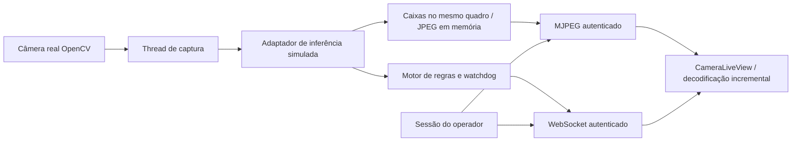

# Câmera ao vivo — módulo local

O dashboard React contém CameraLiveView, integrado ao FastAPI por MJPEG e
WebSocket. A fonte de vídeo é uma câmera local real via OpenCV. Não existe vídeo
de demonstração substituindo uma câmera ausente.

A inferência, o sensor e a sinalização permanecem simulados nesta etapa. As caixas
têm posições ilustrativas fixas e não acompanham os pixels. A interface e cada
quadro com sobreposições identificam isso explicitamente. Nenhuma saída física é
acionada por uma verificação simulada.

## Execução no Windows

Use Python >= 3.11 e uma versão Node compatível com o Vite instalado (validado
neste workspace com Python 3.14 e Node 24). Os exemplos partem da raiz.

```powershell
python -m venv .venv
.\.venv\Scripts\python.exe -m pip install -r ai-service/requirements-dev.txt
npm.cmd --prefix frontend ci
npm.cmd --prefix frontend run build

$env:LIVE_USERNAME = 'instrutor'
$env:LIVE_PASSWORD_HASH = & .\.venv\Scripts\python.exe ai-service/password_hash.py
$env:LIVE_ORIGIN = 'http://127.0.0.1:8000'
.\.venv\Scripts\python.exe ai-service/serve.py
```

O utilitário pede a senha sem exibir os caracteres e retorna somente o hash scrypt.
Não há credencial padrão. Acesse **http://127.0.0.1:8000** e entre com o usuário e a
senha definidos. Use exatamente essa origem; localhost é outra origem.

O arquivo .env.example documenta as variáveis; não é carregado automaticamente.
Não salve senha ou hash no código nem no Git. Configure as variáveis no ambiente do
serviço. O servidor rejeita inicialização sem credencial configurada.

## Raspberry Pi / Linux

```sh
python3 -m venv .venv
.venv/bin/python -m pip install -r ai-service/requirements.txt
export LIVE_USERNAME=instrutor
export LIVE_PASSWORD_HASH="$(.venv/bin/python ai-service/password_hash.py)"
export LIVE_ORIGIN=http://127.0.0.1:8000
.venv/bin/python ai-service/serve.py
```

Gere frontend/dist com npm ci e npm run build em frontend antes de iniciar o
serviço; pode fazê-lo no computador de desenvolvimento e copiar o resultado para
o mesmo caminho no Pi. A aplicação serve os arquivos do build na mesma origem.

A câmera padrão é índice 0, com resolução solicitada 960×540 e limite de 12 FPS.
LIVE_CAMERA_INDEX, LIVE_WIDTH, LIVE_HEIGHT e LIVE_FPS ajustam esses valores.
Resolução/FPS efetivos dependem do driver; a interface mostra a taxa medida.
USB/V4L2 é o caminho inicial. Uma câmera CSI que não apareça como dispositivo
OpenCV requer adaptador Picamera2/libcamera ou GStreamer validado no Pi;
esta versão não afirma compatibilidade automática com todo módulo CSI.

Não foi encontrada câmera no computador de desenvolvimento. A captura ao vivo e
o desempenho ARM64 precisam ser validados no Raspberry Pi com o dispositivo real.
O diagnóstico abaixo tenta capturar por até quatro segundos, sem salvar ou exibir
imagens e sem abrir rede:

```sh
.venv/bin/python ai-service/probe_camera.py
```

No Windows use .venv/Scripts/python.exe.

## Acesso pela LAN

HTTP é permitido somente em loopback. Para outro computador visualizar o Pi,
configure HTTPS, certificado válido para a origem institucional e uma sub-rede
explicitamente autorizada. Exemplo de valores, a adaptar à sala:

```text
LIVE_ORIGIN=https://192.168.10.20:8000
LIVE_BIND=192.168.10.20
LIVE_ALLOWED_NETWORKS=192.168.10.0/24
LIVE_TLS_CERT=/etc/tecnosolda/certificado.pem
LIVE_TLS_KEY=/etc/tecnosolda/chave.pem
```

O lançador exige TLS para bind fora de loopback. Não configure port forwarding,
túnel público ou publicação externa. O firewall do Pi e a segmentação da rede
devem permitir apenas os terminais autorizados da sala. A aplicação verifica o IP
do par TCP e ignora X-Forwarded-For; não a coloque atrás de proxy sem revisar essa
política. A autenticação e a sub-rede não comprovam presença física: a instituição
continua responsável pelo controle de terminais, credenciais e acesso à sala.

Use um único processo/worker. Câmera, sessões e histórico ficam em memória local;
vários workers duplicariam captura e produziriam sessões inconsistentes.
Não executar o servidor interno do Vite na LAN. Em desenvolvimento local,
LIVE_ORIGIN=http://127.0.0.1:5173 e LIVE_PORT=8000 permitem usar o proxy do Vite
com npm run dev em frontend.

## Fluxo e sincronização



As caixas e os rótulos são desenhados antes da codificação JPEG, no servidor.
Assim a imagem e suas caixas pertencem sempre ao mesmo quadro, sem depender da
sincronização entre MJPEG e WebSocket. O componente apresenta também uma lista
de metadados de detecção recebidos por WebSocket.

O produtor guarda somente o último quadro e o compartilha entre operadores.
O cliente decodifica o multipart por Content-Length, descarta quadros
intermediários recebidos juntos e revoga as URLs de imagem anteriores.
Não há gravação nem fila crescente de vídeo. O buffer do parser tem limite.

O watchdog roda a cada 100 ms fora da thread de captura/inferência. Quadros
expirados, captura bloqueada e desconexões invalidam a verificação e cessam
a transmissão de imagens antigas. O frontend exige estados e imagens recentes
(até 1,5 s) para exibir a indicação verde simulada; falha explícita recebida a
remove na atualização. Esses limites incluem o intervalo de atualização,
não prometem resposta física instantânea.

A métrica de latência representa captura + processamento/codificação no servidor,
não a latência completa até o monitor. FPS é a taxa observada de quadros produzidos.
Para baixa latência ou muitas estações, medir a rede e avaliar WebRTC com sinalização
autenticada, sem encaminhar vídeo por serviços externos. WebRTC não foi implementado.

## Operação da demonstração

1. Entre no dashboard. Sem câmera, veja mensagem de indisponibilidade; não há imagens fictícias.
2. Com a câmera conectada, o vídeo permanece disponível enquanto a tocha está no suporte.
3. Abra Controles de demonstração e reconheça que os resultados são simulados.
4. Aplique EPIs presentes / máscara levantada. Aguarde a etapa inicial completar.
5. Aplique Máscara abaixada. Após novos quadros, aparece o resultado satisfatório simulado.
6. Aplique Perda de visibilidade, luva oculta ou processamento indisponível: o verde desaparece.
7. Para revalidar, repita a etapa da máscara levantada antes da abaixada.
8. Devolver tocha encerra a sessão de monitoramento. Sair encerra o acesso ao vídeo.

A demonstração gera exatamente quatro categorias: avental, luvas (duas evidências),
respirador e máscara de soldagem. Quando abaixada, a máscara oculta o respirador:
não se desenha uma caixa fictícia de respirador visível nessa etapa.

Verde/vermelho do motor e alarme são resultados simulados. physical_outputs_connected
é sempre false. Instalar ou conectar GPIO e usar resultado para sinalização real
exige outra etapa, modelo validado e instalação técnica autorizada.

## Autenticação e autorização

Há uma conta de operador provisionada por ambiente, apropriada para a primeira
cabine. Sessões opacas ficam no servidor, com duração absoluta padrão de 15 minutos
(LIVE_SESSION_SECONDS, entre 5 e 3600). Não há renovação automática.
Cookies são HttpOnly, SameSite=Strict e Secure quando em HTTPS. Tokens de sessão
não são enviados por URL nem armazenados em localStorage.

Vídeo, metadados, histórico e controles exigem perfil operador autenticado. Escritas
exigem origem exata e token CSRF mantido em memória pelo frontend. WebSocket exige
a mesma origem. O endereço MJPEG isolado responde 401 sem sessão.

O gerador MJPEG e o WebSocket revalidam a sessão continuamente. Uma tarefa de
expiração interrompe também uma escrita de vídeo bloqueada. Logout revoga o
token no servidor, interrompe conexões e remove o vídeo no cliente. Não se promete
apagar bytes que um cliente autorizado já recebeu.

Login tem limite de cinco tentativas por IP/minuto. Sessões e tabelas de limites
são limitadas em memória; conexões têm teto global e por sessão. Respostas usam
no-store, bloqueio de framing e política de conteúdo local.

Login, falha de acesso, abertura de vídeo, logout, mudanças de demonstração e
reconhecimento de alarme geram eventos. O histórico do motor tem até 1.000 eventos;
o painel recebe os 100 mais recentes. Reinício limpa sessões e histórico.
Reconhecer alarme não constitui revisão técnica do evento nem libera o verde.

## Endpoints

| Método | Caminho | Finalidade |
| --- | --- | --- |
| POST | /api/auth/login | Login com usuário e senha; origem obrigatória |
| GET | /api/auth/session | Sessão, CSRF e validade restante |
| POST | /api/auth/logout | Revogação; exige CSRF |
| GET | /api/live/video.mjpg | MJPEG protegido |
| WS | /api/live/ws | Estado, sensor, métricas, caixas e últimos eventos |
| GET | /api/live/status | Snapshot protegido |
| GET | /api/alerts | Histórico em memória |
| POST | /api/simulation | Sensor/cenário simulados; exige CSRF |
| POST | /api/alerts/acknowledge | Reconhecer incidente sonoro; exige CSRF |

## Substituir pela IA treinada

O contrato LiveDetector, em app/live/inference.py, recebe imagem, sequência e
horário monotônico e devolve Inference com Frame tipado e caixas normalizadas
(x1, y1, x2, y2). CameraPipeline recebe o detector por injeção. A captura e a
transmissão não dependem de uma implementação YOLO.

A integração real deve validar as classes treinadas, associar EPIs à pessoa e
distinguir mãos e posição da máscara. Ausência de detecção deve virar INCONCLUSIVO,
não AUSENCIA_OBSERVADA. A pessoa/rastreamento não podem ser presumidos como no
gerador de demonstração. Não usar reconhecimento facial.

Para habilitar modo real, substituir também a seleção de modo e os metadados de
simulação no runtime e revisar a política de saídas; não basta mudar o rótulo da
interface. Não carregar pesos genéricos como se reconhecessem EPIs de soldagem.
As indicações atuais de simulação são deliberadamente fixas até essa integração.

## Validação

```powershell
.\.venv\Scripts\python.exe -m unittest discover -s ai-service/tests -v
npm.cmd --prefix frontend test
npm.cmd --prefix frontend run build
cd frontend
node tests/browser-smoke.mjs
```

O teste de navegador usa Microsoft Edge instalado, servidor exclusivo em loopback
e câmera indisponível, sem imagens de pessoas. LIVE_BROWSER_CHANNEL pode escolher
outro canal instalado e LIVE_TEST_PYTHON outro executável Python.
As capturas de QA ficam em test-artifacts, ignorado pelo Git.

A suíte cobre autenticação, rede/origem, CSRF, vídeo desprotegido, expiração/revogação,
escrita MJPEG bloqueada, quadros antigos, mudanças de cenário, sequência inicial,
separação de saídas físicas e simuladas, decodificação multipart, interface sem
verde após desconexão, layout móvel e retorno ao login após expiração.
Testes com arrays de pixels são fixtures de codec, nunca usados como câmera real.

Referências técnicas consultadas:
[FastAPI WebSockets](https://fastapi.tiangolo.com/advanced/websockets/),
[cookies de resposta](https://fastapi.tiangolo.com/advanced/response-cookies/),
[OpenCV VideoCapture](https://docs.opencv.org/4.x/d8/dfe/classcv_1_1VideoCapture.html)
e [Vite](https://vite.dev/guide/).
