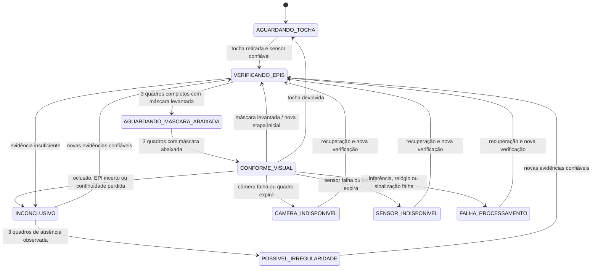

# Máquina de estados e invariantes

As regras globais abaixo valem de qualquer estado; o diagrama reduz o número de
setas repetidas. A recuperação pode passar por INCONCLUSIVO enquanto ainda não
há imagem suficiente.

| Evento/condição | Resultado obrigatório |
| --- | --- |
| Sensor confiável informa tocha no suporte | Encerra sessão uma vez; limpa todas as verificações; ambas as luzes e som desligados |
| Sensor indisponível, futuro ou com idade > 1 s | SENSOR_INDISPONIVEL, verde desligado; não inferir retorno da tocha |
| Retirada com sensor confiável | Abre exatamente uma sessão nova; a retirada não comprova arco aberto |
| Sem quadro, câmera indisponível ou idade > 0,75 s | CAMERA_INDISPONIVEL; verde desligado e cache invalidado |
| Processamento indisponível ou quadros fora de ordem | FALHA_PROCESSAMENTO; verde desligado e cache invalidado |
| Pessoa invisível, múltiplas pessoas, track incerto ou trocado | INCONCLUSIVO; revalidação completa |
| Intervalo > 0,75 s entre quadros, mesmo com quadro novo | INCONCLUSIVO; impede reutilização do respirador após lacuna |
| Qualquer EPI visível não confirmado | Verde desliga no primeiro quadro; ausência só é classificada após persistência |
| Máscara levantada após verde | Etapa inicial refeita; respirador precisa estar visível |
| Reconhecimento do alarme | Silencia o incidente corrente; não altera estado nem cache |
| Falha de saída | FALHA_PROCESSAMENTO; comando seguro tentado; signaling_ok=false se não há confirmação |

Verde exige simultaneamente: sessão ativa, tocha retirada com leitura válida,
etapa inicial concluída, máscara abaixada confirmada temporalmente, pessoa única
e visível com continuidade confiável, avental e ambas as luvas confirmados,
câmera e processamento válidos. O respirador pode estar oculto somente pela
máscara abaixada após sua verificação inicial.

Em repouso não se reaproveitam resultados exibidos de EPIs. A sequência global
de quadros é preservada para rejeitar replays. Um adaptador que reinicie sua
numeração deverá reiniciar o motor, encerrando a sessão com segurança.

O alarme possui estado separado: sem incidente, em atraso, pulso ativo,
aguardando intervalo ou reconhecido. Padrões: atraso de 1 s, pulso de 0,5 s e
intervalo mínimo de 5 s entre acionamentos, inclusive se mudar o motivo.
POSSIVEL_IRREGULARIDADE, INCONCLUSIVO e falhas podem gerar som. A espera normal
pela máscara não gera som por padrão. Esses parâmetros são alteráveis em
AlarmConfig; os parâmetros temporais visuais ficam em Config.

O watchdog apaga o verde ao detectar ausência de quadros; não é possível
detectar uma falha antes da próxima execução do controlador. Na integração real,
a latência máxima inclui timeout e intervalo do watchdog. Um processo travado,
falta de energia ou relé preso exigem mecanismos físicos de desenergização e
feedback; o software simulado não oferece essa garantia.
