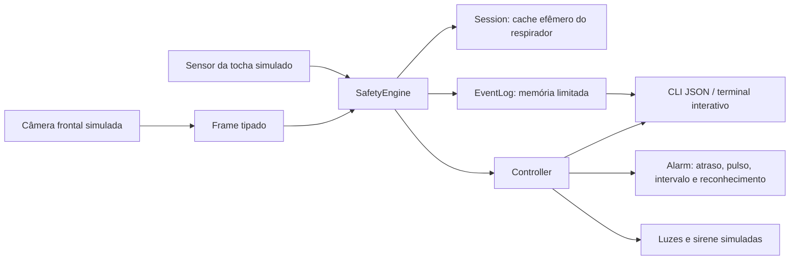
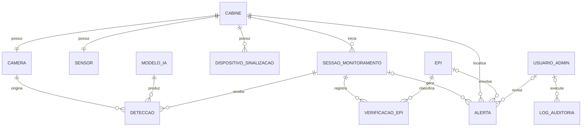

# Plano técnico — primeira cabine

> Registro da entrega inicial de simulação. O módulo posterior de câmera real,
> FastAPI e dashboard está documentado em [Câmera ao vivo](camera-ao-vivo.md).
> As limitações abaixo descrevem a entrega inicial, não o estado completo atual.

## Inspeção e escopo

Na inspeção inicial o repositório continha somente README.md, com o roteiro
pedagógico do encontro de 22/10/2026. Não havia aplicação, dependências,
banco, testes nem recursos implementados para reutilizar. O roteiro foi preservado.

Esta entrega atende à tarefa inicial: plano técnico e protótipo executável da
máquina de estados com uma câmera frontal, sensor, luzes e sirene simulados.
Não implementa ainda captura de imagens, inferência, serviços HTTP, dashboard,
banco, autenticação de rede ou GPIO. Não abre portas nem publica serviços.

## Componentes e direção dos dados

| Módulo | Responsabilidade |
| --- | --- |
| app/models.py | Evidências tipadas, estados, configuração, quadro e leitura do sensor |
| app/safety_rules.py | Sequência, continuidade, validade temporal e escolha do estado |
| app/session_manager.py | Uma sessão ativa; UUID operacional sem identificar aluno |
| app/epi_validator.py | Avental e cada uma das duas luvas separadamente |
| app/events.py | Eventos com horário UTC, cabine, sessão, origem, EPI e revisão pendente |
| app/alarm.py | Políticas sonoras, intervalo global e reconhecimento por perfil |
| app/controller.py | Execução serial e tratamento de falhas de processamento/sinalização |
| app/camera.py e app/detector.py | Contratos para adaptadores futuros |
| hardware/simulator | Fonte sintética de quadros e sensor |
| hardware/signaling.py | Contrato de saída e implementação simulada |
| app/main.py | Cenários e operação interativa com tempo virtual |

## Decisões técnicas

1. **Python >= 3.11 e biblioteca padrão nesta fase.** Evita depender de câmera,
   pesos ou pacotes binários para testar regras. Executado localmente em Python
   3.14 no Windows; compatibilidade real em Raspberry Pi ainda precisa ser medida.
2. **Motor independente de transporte e IA.** FastAPI será uma camada sobre o
   motor; o futuro backend não deverá duplicar a lógica que decide o verde.
3. **Evidência em três estados.** PRESENTE, AUSENCIA_OBSERVADA e INCONCLUSIVO.
   Não detectar um objeto não prova ausência. O adaptador real deverá justificar
   ausência com visibilidade suficiente da região correspondente.
4. **Confirmação por quadros distintos consecutivos.** Padrão: três quadros para
   EPIs com máscara levantada e três para máscara abaixada. Esse número é um
   parâmetro de protótipo, não um limiar validado na oficina.
5. **Política conservadora para incerteza.** Uma observação inconclusiva apaga o
   verde e invalida a etapa inicial; é necessária a sequência completa novamente.
   A classificação de possível ausência exige três quadros de evidência explícita.
6. **Cache de respirador apenas na sessão corrente.** Retorno da tocha,
   perda de visibilidade, troca de track, falha ou intervalo excessivo o invalidam.
   Respirador oculto pela máscara abaixada é permitido após a etapa inicial.
7. **Alarme é ortogonal à máquina de verificação.** Reconhecer som não muda o
   estado visual nem libera verde. Falha de sinalização é uma falha técnica.
8. **Tempo monotônico para decisão; UTC para eventos.** A CLI avança um relógio
   virtual. Um futuro serviço precisará chamar step em um watchdog independente
   da chegada de quadros; uma leitura bloqueante de câmera não pode bloquear isso.
9. **Memória limitada.** Até 1.000 eventos, sem persistência automática. A CLI
   imprime JSON, que pode ser redirecionado explicitamente pelo operador.
10. **Sem identidade do aluno.** O track é efêmero e não aparece no histórico.
    A identidade do operador simulado aparece somente no reconhecimento do alarme.

## Fases seguintes e critérios de aceite

| Fase | Implementação prevista | Critério de aceite |
| --- | --- | --- |
| 1 — arquitetura | Plano, componentes, estados, modelo conceitual | Documentos versionados e testes das regras |
| 2 — protótipo | CLI, evidências, sensor e sinalização sintéticos | Sequência completa e falhas reproduzíveis; entrega atual |
| 3 — visão | OpenCV, reconexão, YOLO personalizado, associação e posição da máscara | Dataset autorizado; métricas por EPI e posição; ausência/oclusão diferenciadas |
| 4 — serviços | FastAPI local + Node/TypeScript/Express, PostgreSQL/Prisma e WebSocket | Validação, migrations, autenticação, perfis, auditoria e reconexão |
| 5 — dashboard | React/TypeScript/Vite/Tailwind | Estado e indicadores, histórico filtrável e configurações; vídeo restrito e opcional |
| 6 — Pi 5 | ARM64, adaptação GPIO autorizada, watchdog físico e medição | FPS, latência p95, CPU, RAM, temperatura e falhas medidos no dispositivo |
| 7 — oficina | Ensaios supervisionados | Critérios de aceitação aprovados por instrutor e responsável técnico |

Antes de fixar versões de OpenCV, Ultralytics, PyTorch, ONNX Runtime ou outro
runtime, verificar suporte ARM64 e compatibilidade do modelo exportado.
Não há otimização de inferência nem medição de desempenho de IA nesta entrega.

Na fase de treinamento: classes pessoa, avental_soldagem, luva_soldagem,
mascara_soldagem e respirador_valvula. Estados da máscara e mãos esquerda/direita
precisam de solução e avaliação próprias. Dividir dados por gravação/sessão,
sem quadros quase idênticos entre treino e teste; medir precision, recall, F1,
confusão, falsos positivos/negativos, oclusão, FPS e latência.

## Modelo conceitual de persistência (a implementar)

| Entidade | Campos principais e restrições propostas |
| --- | --- |
| CABINE | UUID, código único, ativa; uma cabine no primeiro deployment |
| CAMERA | cabine única, origem local, estado; credenciais fora dos logs |
| SENSOR | cabine única, tipo, estado, última leitura |
| EPI | código único; exatamente avental, máscara de soldagem, luvas e respirador |
| SESSAO_MONITORAMENTO | cabine, início, fim, estado e motivo; sem aluno |
| DETECCAO | sessão, câmera, modelo, sequência, horário, classe, confiança e região; sem imagem |
| VERIFICACAO_EPI | sessão, EPI, lado opcional, evidência, fase, validade, motivo |
| ALERTA | cabine, sessão opcional, EPI opcional, tipo, estado, origem, horário, revisão e revisor |
| DISPOSITIVO_SINALIZACAO | cabine, tipo, estado solicitado, confirmação de saída, falha |
| MODELO_IA | versão, hash, classes, parâmetros, métricas, aprovação |
| USUARIO_ADMIN | login único, hash de senha, perfil, ativo; somente operadores |
| LOG_AUDITORIA | ator opcional, ação, alvo, resultado, horário; sem vídeo ou segredos |

Planejar índice único parcial para uma sessão aberta por cabine; índices
(cabine, horário), (estado, horário) e (tipo, horário) nos alertas; unicidade de
(câmera, sessão, sequência) nas observações e chaves estrangeiras em todas as
relações. Não permitir que mudanças de configuração desativem uma das quatro
categorias obrigatórias. Tabelas de detecção devem ter retenção limitada.
Alertas técnicos podem existir sem sessão, por exemplo sensor indisponível no repouso.

Migrations Prisma/SQL, validação de payload e transações serão entregues junto
com o backend; este diagrama não afirma que já existe banco operacional.

## Integração de rede futura

FastAPI restrito a loopback ou socket local. Backend deve autenticar operadores,
aplicar perfis e sessões em cookies seguros, validar origem/CSRF, limitar tentativas
e autenticar também o WebSocket. Servir somente em interfaces LAN autorizadas,
com firewall e segmentação definidos pela instituição. Acesso à LAN não comprova
presença na sala. O modo de vídeo deverá ser opt-in, sem gravação por padrão.

A perda de backend, vídeo ou cliente não poderá manter um verde antigo no dashboard:
mensagens precisarão de sequência e validade; cliente desconectado exibirá estado
desconhecido. A decisão e o watchdog de sinalização permanecem no dispositivo local.
